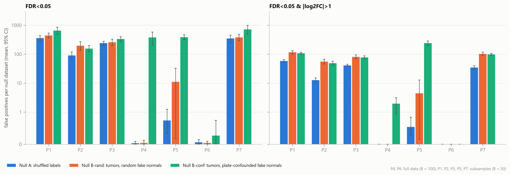
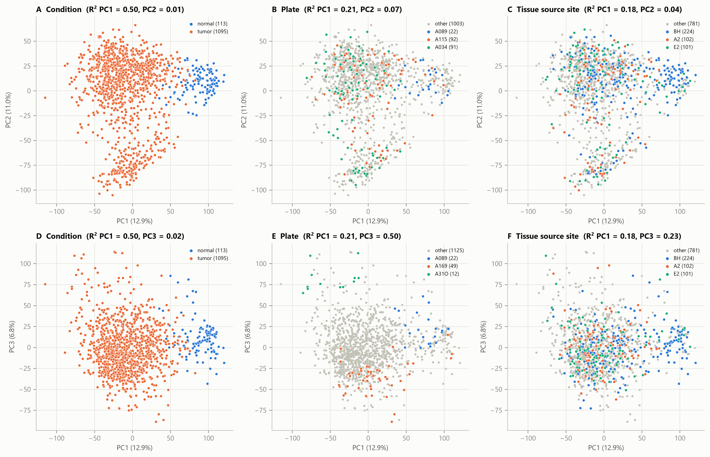

# Gene Expression Analysis of Tumor and Normal Tissue in Breast Cancer (TCGA-BRCA)

## Aim

Differential expression (DE) between primary breast tumors and solid tissue normals in
TCGA-BRCA, with one specific question: **how much do batch effects and the choice of DE
method contribute to false positives?** Seven DE protocols are compared on the same data,
and their false positives are measured with null designs that separate method-driven
from batch-driven errors.

## Data

- 1231 GDC STAR "augmented gene counts" files (GENCODE v36). The `unstranded` column is
  used, and the `N_*` summary rows are dropped.
- Aliquot barcodes come from the GDC repository metadata JSON; plate and TSS are parsed
  from them. Center is 07 for every sample, so it is not used as a batch variable.
- Kept samples: primary tumor (01) and solid tissue normal (11), one aliquot per patient
  and condition (alphabetically first). This gives **1095 tumors and 113 normals**. The
  7 metastatic samples are removed.
- 113 patients are paired (tumor + normal); in 89 of them both sit on the same plate.
- Plates: 44, of which 17 contain normals. A089 holds 22 normals and no tumor. TSS: 40.
- Genes: protein-coding genes with CPM >= 1 in >= 113 samples, giving **15317 genes**.
- Plate and condition are strongly confounded: Cramér's V = 0.55, and plate explains 50%
  of PC3. Plates with < 10 samples are merged with neighbours in plate-ID (processing)
  order into 38 `batch_group`s. Only 15 of them hold both conditions (615 samples).

## Protocols

| | Method |
|---|---|
| P1 | PyDESeq2 `~condition` (apeGLM-shrunken log2FC) |
| P2 | PyDESeq2 `~batch_group + condition` |
| P3 | ComBat-seq (R `sva`, batch = `batch_group`, condition protected), then PyDESeq2 `~condition` |
| P4 | Wilcoxon rank-sum on DESeq2-normalized counts |
| P5 | ComBat-seq, then Wilcoxon rank-sum |
| P6 | van Elteren stratified Wilcoxon, strata = `batch_group` (own implementation, validated in `tests/`) |
| P7 | Counts winsorized at the 95th percentile within condition (Yang et al. 2024 procedure), then PyDESeq2 `~condition` |

DEG = Benjamini-Hochberg FDR < 0.05 and |log2FC| > 1. For the rank protocols, log2FC is
log2(median tumor + 1) - log2(median normal + 1) on normalized counts.

## Null designs (Stage 4)

- **Null A (method-driven, replicates Li et al. 2022):** tumor/normal labels are
  shuffled over all samples. Gives FP_A.
- **Null B (batch-driven, main novel analysis):** tumors only, so every DEG is false.
  Fake normals (9.35%) are drawn either at random (**B-rand**, FP_rand) or to mimic the
  real plate structure (**B-conf**, FP_conf; plate x label Cramér's V matched to the
  real data). **FP_batch = FP_conf - FP_rand**, paired by replicate.
- **Null C (secondary):** labels are shuffled within the 15 batch groups that hold both
  conditions.
- **Counting and replicates:** false positives are counted at FDR < 0.05, and at
  FDR < 0.05 with |log2FC| > 1. Rank protocols P4 and P6 use the full sets with B = 100.
  P1, P2, P3, P5 and P7 use balanced subsamples with B = 50: Null A uses all normals plus
  3x random tumors, Null B uses 452 tumors.

## Repository layout and how to run

```
data/raw/            GDC downloads (not in git)
data/processed/      parquet / csv intermediates, permutation results (not in git)
src/                 load, batch, de_methods, permutation, benchmark, downstream, plots, report
tests/               van Elteren validation (pytest)
scripts/             permutation scheduled-task helpers, notebook builder
notebooks/           analysis.ipynb (Turkish narrative, executed with outputs)
results/figures/     PNG, 300 dpi
results/tables/      CSV
```

Setup: Python 3.11 venv with `pip install -r requirements.txt`. For ComBat-seq, R 4.6.1
and Bioconductor `sva` are also needed (see "R packages" below).

```bash
python -I src/load.py                 # Stage 1: counts.parquet, samples.csv
python -I src/batch.py                # Stage 2: filtering, size factors, batch_group
python -I src/de_methods.py           # Stage 3: de_P1..P7.csv (P3/P5 ~12 min each)
python -I -m pytest tests             # van Elteren validation
python -I src/permutation.py labels --B 100
python -I src/permutation.py run --b-full 100 --b-sub 50   # Stage 4, ~9 h; see below
python -I src/permutation.py summary  # Stage 4 tables + Fig 5
python -I src/benchmark.py            # Stage 5
python -I src/downstream.py           # Stage 6
python -I src/report.py               # Stage 7: Table 1 (results/tables/summary.csv)
python -I scripts/build_notebook.py && jupyter nbconvert --to notebook --execute --inplace notebooks/analysis.ipynb
```

## Key findings

Values below are per null dataset: the mean over replicates with a 95% bootstrap CI, at
FDR < 0.05 (Table 1: `results/tables/summary.csv`).

| | DEG | FP_A | FP_rand | FP_conf | FP_batch [95% CI] | precision / recall vs reference |
|---|---|---|---|---|---|---|
| P1 | 3734 | 357 | 441 | 647 | 206 [14, 424] | 0.68 / 0.78 |
| P2 | 3711 | 91 | 195 | 155 | -41 [-120, 31] | 0.74 / 0.85 |
| P3 | 3804 | 240 | 257 | 334 | 78 [-9, 166] | 0.74 / 0.87 |
| P4 | 3570 | 0.03 | 0.04 | 378 | 378 [209, 578] | 0.85 / 0.94 |
| P5 | 3590 | 0.7 | 11 | 385 | 374 [301, 455] | 0.86 / 0.95 |
| P6 | 3563 | 0.06 | 0.04 | 0.27 | 0.2 [-0.05, 0.7] | 0.86 / 0.94 |
| P7 | 3762 | 347 | 379 | 718 | 339 [87, 617] | 0.75 / 0.86 |

1. **Method-driven false positives (Li et al. replicated).** DESeq2-based protocols
   report hundreds of DEGs on label-shuffled data (P1: 357 per replicate, at least one
   in 100% of replicates), while rank tests report almost none. Because ~12,600 genes are
   significant on the real labels, the estimated FDR stays below 3% (P1: 2.8%).
2. **Batch-driven false positives.**
   - When fake labels follow the plate structure, the plain Wilcoxon test (P4) gains 378
     false positives per replicate. The stratified van Elteren test (P6) stays at zero.
   - ComBat-seq followed by Wilcoxon (P5) also fails (374), and 240 of its false
     positives pass |log2FC| > 1. Protecting a condition covariate that is confounded with
     batch moves batch differences into the condition signal (Nygaard et al. 2016).
   - For the DESeq2 protocols, batch-driven false positives are small-effect genes:
     FP_batch is about 0 once |log2FC| > 1 is required.
3. **Winsorization.** Within-condition winsorization (P7) does not reduce Null A false
   positives (347 vs 357). With one global percentile, as in Yang et al. 2024, they fall
   by 94% (21; 98.7% with |log2FC| > 1), at the cost of fewer real DEGs (3401 vs 3785 on
   the subsample).
4. **Protocol differences are mostly the log2FC definition.** DEG Jaccard between P1 and
   P4 rises from 0.59 to 0.94 when both use the same DESeq2 log2FC. Against the batch-free
   same-plate paired reference (3262 genes), the rank protocols lead with their own
   median log2FC (Jaccard ~0.81). With a common log2FC, the batch-aware protocols
   (P2, P3, P5, P6: 0.66-0.69) lead instead.
5. **Downstream.**
   - All 5 canonical markers are found in the expected direction by every protocol.
   - Tumor/normal classification is at ceiling (nested-CV ROC-AUC >= 0.9994) whatever
     selects the genes.
   - The top enriched terms depend on the method family: GO BP down Jaccard between the
     DESeq2 and rank families is 0.29-0.43.
   - The robust core signature has 1664 genes (v1; 2010 genes in v2) and classifies as
     well as the full P1 list with about half the genes.

## Figures

False positives per protocol under the three nulls (Fig 5):



Batch structure (Fig 2, PCA by condition, plate and TSS):



All figures (300 dpi PNG) in `results/figures/`:
[Fig 2 PCA](results/figures/fig2_pca.png) ·
[Fig 3 plate x condition](results/figures/fig3_plate_condition_heatmap.png) ·
[Fig 4 DEG counts](results/figures/fig4_deg_counts.png) ·
[Fig 5 false positives](results/figures/fig5_false_positives.png) ·
[Fig 6 UpSet](results/figures/fig6_upset.png) ·
[Fig 7 markers](results/figures/fig7_markers.png) ·
[Fig 8 enriched-term overlap](results/figures/fig8_term_jaccard.png) ·
[Fig 9 classification](results/figures/fig9_classification.png)

## Limitations

- **Null B composition.** Tumor subtypes or tissue composition (e.g. adipose content)
  may differ between plates, so part of FP_conf can be biology tied to plates rather than
  technical batch.
- **Null C leaks biology.** Residual label correlation (0.07-0.11) leaks biology into
  Null C; it is reported as secondary only.
- **Fewer replicates for subsample protocols.** DESeq2 and ComBat-seq protocols use
  subsamples and B = 50, so their CIs are wide (e.g. P1 FP_batch [14, 424]).
- **Reference is not independent.** The reference shares its 178 samples with the full
  data, and its Wilcoxon half uses a median log2FC.
- **Classification is too easy to separate protocols.** AUC is at ceiling, and
  P3/P5 are not used as in-fold gene selectors.
- **Some choices are ours.** The plate grouping (processing order = plate ID), the
  within-condition P7 and the top-20-term overlap are choices; alternatives are
  reported where they were checked (P7g, common log2FC, robust core v2).

## References

- Li Y, Ge X, Peng F, Li W, Li JJ. Exaggerated false positives by popular differential
  expression methods when analyzing human population samples. *Genome Biology* 23:79 (2022).
- Yang L, Zhang X, Chen J. Winsorization greatly reduces false positives by popular
  differential expression methods when analyzing human population samples.
  *Genome Biology* 25:282 (2024).
- Zhang Y, Parmigiani G, Johnson WE. ComBat-seq: batch effect adjustment for RNA-seq
  count data. *NAR Genomics and Bioinformatics* 2(3):lqaa078 (2020).
- Nygaard V, Rødland EA, Hovig E. Methods that remove batch effects while retaining group
  differences may lead to exaggerated confidence in downstream analyses.
  *Biostatistics* 17(1):29-39 (2016).
- van Elteren PH. On the combination of independent two-sample tests of Wilcoxon.
  *Bulletin of the International Statistical Institute* 37:351-361 (1960).
- Chen Z, Nersisyan S, Rigoutsos I, Londin E. Systematic Evaluation of Batch Effects in
  The Cancer Genome Atlas Program Underscores the Need for Batch-Controlled Analysis.
  Alpha Omega Alpha Research Symposium Posters, 16. Thomas Jefferson University; 2026.
  https://jdc.jefferson.edu/aoa_research_symposium_posters/16 (conference poster, not
  peer-reviewed).
- Liang S, Liang Q, Chen R, Chen K. Stratified Test Accurately Identifies Differentially
  Expressed Genes Under Batch Effects in Single-Cell Data. *IEEE/ACM Transactions on
  Computational Biology and Bioinformatics* 18(6):2072-2079 (2021).
  doi:10.1109/TCBB.2021.3094650

## Method details and decisions

- **P7 winsorization (within condition).** P7 follows Yang et al. 2024 (Genome Biology
  25:282): counts are divided by DESeq2 size factors, each gene's normalized values above
  its 95th percentile are replaced by that percentile, then multiplied back by the size
  factors and rounded. The paper does not state whether the percentile is computed over
  all samples or per group. Computing it over all samples clipped the normals (~9% of
  samples) on down-regulated genes (ADH1B log2FC -3.57 vs -5.10 in P1), so the
  percentile is computed **within each condition**. The earlier global version is kept as
  `results/tables/de_P7_global.csv`. In permutation analyses the winsorization follows
  the permuted labels.
- **P5 permutations on the subsample.** ComBat-seq takes ~12 min per run on the full
  data (1208 samples), so P5 permutations, like the DESeq2 protocols, run on the
  balanced subsample instead of the full data. P3 and P5 share one ComBat-seq run per
  replicate.
- **Common log2FC sensitivity** (`results/tables/de_common_lfc/`). DEGs are re-called
  with each protocol's own FDR and a shared DESeq2 log2FC: P1 shrunken LFC for P1, P4,
  P7; P2 (~batch + condition) for P2, P6; P3 (ComBat-seq) for P3, P5.
- **Replicates.** Rank protocols on the full sets (P4, P6): B = 100. Subsample protocols
  (P1, P2, P3, P5, P7, plus P4/P6 on the subsamples as a check): B = 50, because of
  the DESeq2 and ComBat-seq cost (the full run took ~10 h on 14 cores / 32 GB RAM).
- **Stage 4 null designs** (`src/permutation.py`, summary: `python src/permutation.py summary`).
  Null A shuffles tumor/normal labels over all samples. Null B uses tumors only (one per
  patient; every DEG is false): B-rand picks fake normals at random, B-conf mimics the real
  plate structure (~20% of fake normals on plates that become fake-normal-only, the rest on
  "mixed" plates at real normal fractions) and is redrawn until its plate x label Cramér's V
  is within 0.03 of the real data's V (0.552 full, 0.630 subsample). Both use the same
  samples and the same number of fake normals (9.35%); batch groups are rebuilt on the
  tumor-only sets with the Stage 2 rule. FP_batch = FP_conf - FP_rand, paired by replicate.
  Null C (secondary) shuffles labels within the 15 batch groups that hold both conditions.
  The original "restricted permutation over all batch groups" was dropped: single-condition
  groups keep their true labels, so permuted and true labels correlated at 0.29 (full) and
  0.44 (subsample) and real biology leaked into the null. Subsamples: Null A all 113
  normals + 339 random tumors; Null B 452 random tumors. FDR_A = mean FP_A / number of
  real-label positives on the same samples (subsample real run for P1-P3, P5, P7; full
  Stage 3 results for P4, P6). Error bars are 95% bootstrap CIs over replicates (seed 42).
- **Batch-sensitive genes** (`results/tables/batch_sensitive_genes.csv`): significant
  (FDR < 0.05) in >= 10% of B-conf replicates of a protocol. `batch_specific_*` additionally
  requires < 10% of B-rand replicates, separating batch-driven genes from genes that a
  method flags under any random labelling.
- **Limitations of the null designs.** Null B: tumor subtypes may be unevenly spread over
  plates, so part of FP_conf can come from biology tied to plates rather than technical batch.
  Null C: a residual label correlation remains (mean 0.07 full, 0.11 subsample) through
  differing tumor fractions between batch groups, and FP counts rise with it (Spearman
  0.83 for P1), so Null C mixes batch and biological signal.
- **P7 global vs within-condition winsorization** (`results/tables/p7_winsorization_comparison.csv`).
  A sensitivity variant "P7g" uses one global 95th percentile (otherwise the Yang et al.
  procedure). On the Null A subsample (B = 50, paired replicates) P7g cut false positives
  by 94% vs P1 at FDR < 0.05 (357 -> 21) and by 98.7% with |log2FC| > 1, in line with Yang
  et al. (98.2% fewer DEGs for DESeq2 at the 93rd percentile). Within-condition P7 cut them
  by only 3% (347). On real labels P7g finds fewer DEGs (3401 vs 3785 for P7 on the
  subsample). P7 in the main tables remains the within-condition version.
- **Stage 5 reference** (`src/benchmark.py`): the 89 same-plate tumor/normal pairs (178
  samples, 14 plates). Wilcoxon signed-rank on per-patient differences of log2(norm + 1)
  (log2FC = median difference) and PyDESeq2 `~ patient + condition`; reference = DEG
  (FDR < 0.05, |log2FC| > 1) in both, same direction. A protocol DEG is a true positive only
  with the same direction. Caveats: the 178 reference samples are also part of the full
  data the protocols use, and the Wilcoxon half of the reference uses a median-based
  log2FC, which favours the rank protocols' median log2FC; `benchmark_common_lfc.csv`
  repeats the benchmark with the shared DESeq2 log2FC.
- **UpSet plot** (Fig 6): intersection sizes come from `upsetplot.query`; the figure is
  drawn with matplotlib because upsetplot 0.9.0 plotting fails under pandas 3.
- **Stage 6 enrichment** (`src/downstream.py`): gseapy 1.3.1 `enrichr` in offline mode
  (hypergeometric test) on the Enrichr libraries GO_Biological_Process_2023 and
  KEGG_2021_Human, downloaded once to `data/processed/enrichr/`; background = the 15317
  tested genes. Top-20 terms = the 20 smallest adjusted p among terms with FDR < 0.05
  (KEGG up lists have only 8-12 such terms, so their Jaccard uses fewer terms).
- **Stage 6 classification**: nested stratified 5-fold CV (inner 5-fold grid search on
  ROC-AUC; L1-LR C in {0.01, 0.1, 1}; RF 300 trees, max_features in {sqrt, 0.02}),
  class_weight='balanced'. DEG selection is redone inside each outer training fold with
  the protocol's own test (P1, P2, P4, P6, P7). P3 and P5 are not used as in-fold
  selectors: ComBat-seq needs ~10 min per fold and there is no label-free way to adjust
  the held-out fold. Size factors use a median-of-ratios reference from the training fold
  only. ROC-AUC is at ceiling (>= 0.9994) for every protocol. When all C values tie on
  inner AUC, GridSearchCV keeps the first (C = 0.01), giving a very sparse model that
  misses normals at the 0.5 threshold in one fold (P7, P1_fixed: F1 normal ~0.72-0.75).
  `core_fixed` and `P1_fixed` use gene lists chosen on all samples before CV, so they are
  not nested estimates; they compare the two signatures under identical conditions.
- **Robust core** (`results/tables/robust_core.csv`): DEG in P2, P3, P5 and P6 with the
  same direction (2628 genes), minus genes significant in >= 5% of B-conf replicates of any
  of them (964 genes; 674 removed through P5, 346 only through P5) -> 1664 genes. The
  adipocyte markers ADH1B, FABP4 and LEP drop out because P5 flags them in 12-22% of B-conf
  replicates (0% for P6), i.e. the P5 (ComBat-seq + Wilcoxon) false positives drive most
  of the filtering. **Version 2** (`results/tables/robust_core_v2.csv`) keeps the
  four-protocol DEG/direction rule but applies the B-conf filter only to P2, P3 and P6:
  2010 genes (810 up, 1200 down; a superset of v1). ADH1B and FABP4 return; LEP stays out
  (6% of B-conf replicates in P2 and P3). The 346 added genes agree with the paired
  reference in 98.6% of cases (v1 overall: 94.9%).
- **ComBat-seq** runs in R 4.6.1 with Bioconductor sva 3.60.0 through Rscript
  (inmoose has no Windows wheel).

## Stopping and resuming the permutation run (Stage 4)

All commands run from the repository root. Python is the project venv
(`.venv/Scripts/python` on Windows, `.venv/bin/python` elsewhere). ComBat-seq needs
`Rscript` (R 4.6.1 with Bioconductor `sva`); it is found under `C:\Program Files\R`.

**Inputs that must already exist** (made by Stages 1-2 and the label step):
`data/processed/counts_filtered.parquet`, `data/processed/samples.csv` and the label sets
`data/processed/perm/labels_*.parquet`. If the label files are missing, recreate them
with `python src/permutation.py labels --B 100` (deterministic, seed 42; same labels every time).

**R packages.** Rscript is launched with `R_LIBS_USER` set to the project folder `.rlib/`
(gitignored) holding `sva` and its dependencies. This matters on Windows: R libraries
installed from inside a packaged app (such as the Claude desktop app) are redirected into
that app's private storage and are invisible to a scheduled task. If `.rlib/` is missing,
recreate it with `Rscript -e ".libPaths('.rlib'); install.packages('BiocManager', lib='.rlib',
repos='https://cloud.r-project.org'); BiocManager::install('sva', lib='.rlib', ask=FALSE, type='binary')"`.

**Recommended on Windows: start (or resume) as a scheduled task.** This keeps the run
alive when a terminal or Claude session closes (a run started from a Claude session was
killed when the session ended):

```powershell
powershell -NoProfile -ExecutionPolicy Bypass -File scripts\start_permutation_task.ps1
```

It registers the one-off task `TCGA_BRCA_permutation`, which runs
`scripts/run_permutation_task.cmd` hidden. The wrapper appends to
`results/logs/perm_task.log` (start time, runner exit code, final `status`) and deletes the
task when the runner exits - whether finished, stopped with the STOP file, or failed. Check
whether it is still running with `Get-ScheduledTask -TaskName TCGA_BRCA_permutation`
(no task = not running). If an R worker fails, the runner logs `ERROR: ComBat-seq failed`
in `results/logs/permutation.log` and stops instead of skipping P3/P5.

**Start (or resume) the run directly** - the same command does both; finished work is skipped:

```bash
.venv/Scripts/python -I -u src/permutation.py run --b-full 100 --b-sub 50 --n-cpus 8 >> results/logs/perm_run.out 2>&1
```

Run it in the background (e.g. append `&` in bash, or a background task in Claude Code).
It writes progress to `results/logs/permutation.log` (one line per finished protocol run).
ComBat-seq runs in parallel R processes; their number is chosen at start so that total
RAM use stays below 70% of physical memory (`--max-workers` caps it, default 6).
On Windows the runner asks the OS not to idle-sleep while it runs (released when it
exits); closing a laptop lid still sleeps the machine.

**Check progress** (safe at any time, also while running):

```bash
.venv/Scripts/python -I src/permutation.py status
```

It prints finished replicates per dataset x protocol and `total: done / target`, then
`complete` or `incomplete`. Target is 2216 protocol runs (8 full-data rank cells x 100,
28 subsample cells x 50, plus 16 real-label runs).

**Stop safely:** create the file `data/processed/perm/STOP`:

```bash
touch data/processed/perm/STOP
```

The runner finishes the protocol run it is on (at most ~1 min), terminates its R
workers, logs `STOP file found ... exiting` and exits. The STOP file is removed
automatically by the next `run`. If the process was killed hard instead (crash, reboot,
closed terminal), nothing is corrupted - results are written atomically - but leftover R
processes may keep running; stop them first (PowerShell: `Get-Process Rscript | Stop-Process`).

**Resume:** run the start command again. Each protocol result is one file,
`data/processed/perm/results/<dataset>/<protocol>/<rep>.npz` (per-gene p-values and
log2FC), saved right after it finishes; only missing files are computed. ComBat-seq output
that was not yet used when the run stopped is recomputed.

**When `status` says `complete`:** continue with the Stage 4 summary (FP counts, FDR
estimates, batch-sensitive genes, Fig 5).
